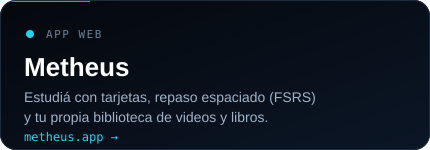
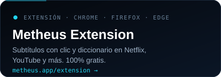

 

  

## Qué estoy construyendo

**[Metheus](https://metheus.app)** es una plataforma para aprender idiomas por inmersión: mirás videos y leés con subtítulos interactivos, guardás cada palabra con su oración y la repasás con repetición espaciada.

- **Local-first:** la app responde al instante en tu dispositivo y sincroniza la cuenta en segundo plano.
- **Extensión gratis** para Chrome, Firefox y Edge, conectada con la app web.
- **Cursos 1K Essentials:** las 1.000 palabras más frecuentes en 10 idiomas.

### Mi racha, devorada por un gusano

Se regenera solo cada 12 horas · <a href="https://metheus.app">metheus.app</a>

