<a href="https://metheus.app"><b>Metheus</b></a> &nbsp;·&nbsp; <a href="https://metheus.app/extension">Extensión</a>

 

<picture>
  <source media="(prefers-color-scheme: dark)" srcset="https://raw.githubusercontent.com/GisaacPr/GisaacPr/output/github-snake-dark.svg">
  
</picture>

